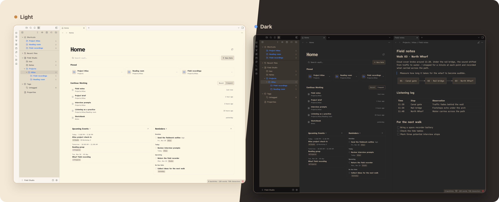

<div align="center">


<h1>Minimal Homepage</h1>

<p><strong>A home tab for the notes you’re working on.</strong><br>Capture into your inbox, pick up a recent note, and glance at what’s next.</p>

<p>
  <a href="https://obsidian.md/"></a>
  <a href="https://github.com/YihDu/obsidian-minimal-homepage/releases"></a>
  <a href="https://obsidian.md/download"></a>
  <a href="#apple-calendar--reminders"></a>
  <a href="https://github.com/YihDu/obsidian-minimal-homepage/actions/workflows/checks.yml"></a>
  <a href="LICENSE"></a>
</p>

<p><a href="https://github.com/YihDu/obsidian-minimal-homepage/releases"><strong>Download preview</strong></a> · <a href="README.zh-CN.md">简体中文</a> · <a href="https://github.com/YihDu/obsidian-minimal-homepage/issues">Report an issue</a></p>

</div>



*Field Studio is a demo vault with fictional notes, events, and reminders. Shown with the [Typewriter theme](https://github.com/crashmoney/obsidian-typewriter).*

[Full light screenshot](docs/images/homepage-preview.png) · [Full dark screenshot](docs/images/homepage-split-dark.png)

<table>
  <tr>
    <td width="33%"><strong>Start with an idea</strong><br>One click opens a blank note in your <code>box</code>. Search is right beside it.</td>
    <td width="33%"><strong>Pick up your work</strong><br>Read your Notebook Navigator pins and return to recent or frequent notes.</td>
    <td width="33%"><strong>Glance at your day</strong><br>See upcoming Apple Calendar events and unfinished Reminders on macOS.</td>
  </tr>
</table>

> GitHub preview · Install manually from Releases. Notebook Navigator and Apple panels are optional.

## Install

**Requires Obsidian Desktop 1.13.0 or later.** This GitHub preview was verified on Obsidian 1.15.1 for macOS. The Apple panels require macOS 14 or later and an optional local helper.

1. From the [1.0.0 GitHub release](https://github.com/YihDu/obsidian-minimal-homepage/releases/tag/1.0.0), download `main.js`, `manifest.json`, and `styles.css`.
2. Place those three files directly in `<your vault>/.obsidian/plugins/minimal-homepage/`. If your vault uses a custom config folder, use it in place of `.obsidian`. On macOS, press **⌘⇧.** in Finder to show hidden folders.
3. Restart Obsidian. In **Settings → Community plugins**, enable community plugins if needed, then enable **Minimal Homepage**.
4. Run **Minimal Homepage: Open Homepage** from the command palette, or click the house icon in the ribbon.

Use **Settings → Minimal Homepage** to hide the ribbon icon or open Home on startup. Startup is off by default. GitHub releases are installed manually by replacing the three files and restarting Obsidian.

## Use Home

| Section | What it does |
| --- | --- |
| **Search** | Type a query and press Enter to run Obsidian’s vault-wide search. Enable the core **Search** plugin to use this shortcut. |
| **New Note** | Creates and opens an empty, timestamped Markdown note in a root folder called `box`. A single numbered root folder like `01-box` also works. Create the folder first. |
| **Pinned** | Reads Markdown notes and folders from the active Notebook Navigator profile’s **Shortcuts**. It preserves the order and groups consecutive pins under the same top-level folder. Click a folder to browse it on Home, or click a note to open it. Reopen Home or click refresh after editing your Shortcuts. |
| **Continue Working** | Shows up to five notes per tab. **Recent** orders notes by when you opened them. **Frequent** weights actual opens over the past 14 days toward more recent visits. Repeated opens of the same note within 15 seconds count once for frequency. History starts when you enable the plugin. |

Notebook Navigator is optional. The Shortcut adapter was verified with **3.5.1**, including the format used with device-local profiles. Its settings are read-only. Other versions may change the Shortcut format. The rest of Home is usable without it.

## Apple Calendar & Reminders

The download includes the Home UI. Build the helper on the Mac where you want to use the Apple panels.

1. Install Apple’s command-line developer tools with `xcode-select --install` if needed.
2. Download the **Source code (zip)** from the GitHub release and unzip it. In Terminal, enter the extracted folder and run `bash apple-helper/build.sh`. This builds and locally signs the helper for your Mac. The helper build uses Swift and works without npm.
3. Copy the resulting `apple-helper/apple-reader` to the installed plugin, retaining executable permissions. Its final path is `<your vault>/.obsidian/plugins/minimal-homepage/apple-helper/apple-reader`. You can then refresh Home.
4. Click **Allow access** in **Upcoming Events** and **Reminders** separately. Choose **Full Access** for Calendar if macOS offers that choice. If access was denied, go to **System Settings → Privacy & Security → Calendars / Reminders**, enable the requester shown by macOS, and refresh Home.

**Upcoming Events** shows up to five upcoming or ongoing events from accessible calendars, including all-day and recurring events. **Reminders** lists all incomplete reminders, grouped by overdue, today, upcoming, and no due date. Both panels include source and available details. Use the arrow in either header to open the corresponding Apple app.

Home refreshes both panels when opened, on manual refresh, and about every five minutes while visible. If one source fails temporarily, its last successful data and timestamp can stay visible. Revoking access clears that source’s cached content. The helper only reads EventKit and requests permissions. The Apple data stays on your Mac and is held in memory. Only plugin settings and note-open history are stored in the plugin’s `data.json` inside the vault, so that file can travel with a vault backup or sync.

## Build from source

Use Node.js 22.13 or later.

```sh
npm ci
npm run build
npm test
```

The build type-checks and bundles the plugin. Copy the three files from the install section into your vault to try it. To build the optional Apple helper, run `npm run build:apple-helper` on a Mac with Apple’s command-line developer tools.

## Credits

- [Notebook Navigator](https://github.com/johansan/notebook-navigator) supplies the Shortcuts shown in Pinned.
- [Task Hub](https://github.com/saralaaga/task-hub), [Simple Meeting Sidebar](https://community.obsidian.md/plugins/simple-meeting-sidebar), and [Apple Reminders Plus](https://community.obsidian.md/plugins/apple-reminders-plus) were references for local Apple integrations. The helper runs independently.
- [Obsidian’s developer documentation](https://docs.obsidian.md/) and [Apple EventKit](https://developer.apple.com/documentation/eventkit) provide the APIs. [Homepage](https://github.com/mirnovov/obsidian-homepage) served as a reference when preparing the GitHub documentation.

[MIT License](LICENSE)
