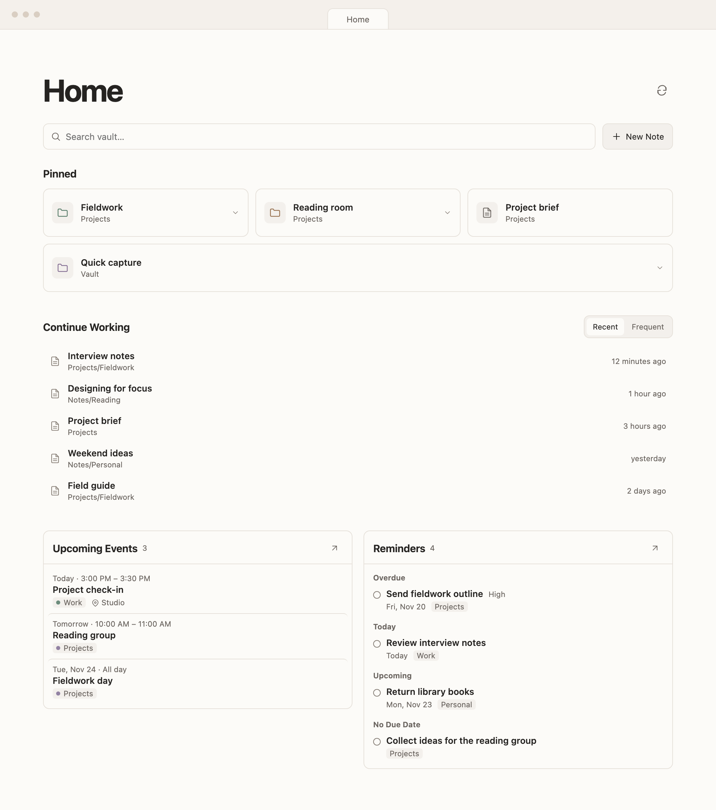

# Minimal Homepage

[English](README.md) · [下载 1.0.0](https://github.com/YihDu/obsidian-minimal-homepage/releases/tag/1.0.0) · [反馈问题](https://github.com/YihDu/obsidian-minimal-homepage/issues)

一个原生的 Obsidian 桌面首页。随手记下一个想法，搜索全库，或回到最近打开的笔记。如果你用 Notebook Navigator，已有的 Shortcuts 会直接出现在首页。macOS 用户还可以查看 Apple 日历和提醒事项。



*浅色主题预览，笔记、日程和提醒均为示例数据。*

## 安装

**需要 Obsidian Desktop 1.13.0 或以上。** 此 GitHub 预览版已在 macOS 上的 Obsidian 1.15.1 验证。Apple 两栏需要 macOS 14 或以上，并另外构建本地助手。

1. 打开 [GitHub 1.0.0 发布页](https://github.com/YihDu/obsidian-minimal-homepage/releases/tag/1.0.0)，下载 `main.js`、`manifest.json`、`styles.css`。
2. 把这三个文件直接放到 `<你的 Vault>/.obsidian/plugins/minimal-homepage/`。如果你的 Vault 使用自定义配置目录，请替换路径里的 `.obsidian`。macOS 可在 Finder 按 **⌘⇧.** 显示隐藏文件夹。
3. 重启 Obsidian，进入 **设置 → 第三方插件**，允许使用第三方插件，然后启用 **Minimal Homepage**。
4. 在命令面板运行 **Minimal Homepage: Open Homepage**，或者点侧栏的房子图标。

在 **设置 → Minimal Homepage** 可以隐藏房子图标，或开启启动时打开首页。启动时打开默认关闭。更新时用新版 Release 的三个文件覆盖旧文件，再重启 Obsidian。

## 使用首页

| 模块 | 用法 |
| --- | --- |
| **Search** | 输入关键词并回车，交给 Obsidian 的全库搜索。请启用核心插件 **搜索**。 |
| **New Note** | 在 Vault 根目录的 `box` 中创建并打开一篇带时间戳的空白 Markdown 笔记。如果只有一个形如 `01-box` 的根目录，也可以用它。使用前请先创建文件夹。 |
| **Pinned** | 读取 Notebook Navigator 当前配置档案里的 **Shortcuts**，支持文件夹和 Markdown 笔记。保留收藏顺序，连续属于同一一级目录的收藏排在同一组。点文件夹可在首页浏览，点笔记直接打开。修改 Shortcuts 后，重开首页或点右上角刷新。 |
| **Continue Working** | 每个标签最多显示 5 篇。**Recent** 按实际打开时间排列。**Frequent** 统计最近 14 天的真实访问，越近期的访问权重越高。同一篇笔记在 15 秒内重复打开只计一次频次。历史从插件启用后开始积累。 |

Notebook Navigator 是可选联动。已核对 **3.5.1** 的 Shortcut 数据格式，包括设备本地配置档案。首页只读其设置。其他版本如果调整了数据格式，可能影响 Pinned。

## 接入 Apple 日历和提醒事项

GitHub 下载包包含首页。要使用 Apple 两栏，请在目标 Mac 本地构建助手。

1. 如还未安装 Apple 命令行开发工具，在终端运行 `xcode-select --install`。
2. 从 GitHub Release 下载 **Source code (zip)** 并解压。在终端进入解压目录，运行 `bash apple-helper/build.sh`。脚本会编译并在本地签名，无需 npm。
3. 把生成的 `apple-helper/apple-reader` 复制到已安装的插件里，保留执行权限。最终路径是 `<你的 Vault>/.obsidian/plugins/minimal-homepage/apple-helper/apple-reader`。然后刷新首页。
4. 在 **Upcoming Events** 和 **Reminders** 中分别点 **Allow access**。如果 macOS 提供日历权限级别，选择 **完全访问**。如之前拒绝授权，前往 **系统设置 → 隐私与安全性 → 日历 / 提醒事项**，为系统列出的请求者开启权限，再刷新首页。

**Upcoming Events** 显示最多 5 条即将开始或仍在进行的日程，支持全天和重复日程。**Reminders** 列出全部未完成任务，按逾期、今天、未来、无截止日期分组。两栏都会展示来源和能读取到的详情。点标题栏箭头可打开对应 Apple App。

打开首页、手动刷新或首页持续可见约五分钟时会更新。某一栏临时读取失败时，可继续显示上次成功的内容和时间。撤销权限后，对应内容会从缓存清除。助手只通过 EventKit 读取数据和申请权限。Apple 数据只在本机内存中处理。插件设置和笔记访问历史保存在 Vault 内的插件 `data.json` 中，Vault 的备份或同步可能带上该文件。

## 从源码构建

使用 Node.js 22.13 或以上。

```sh
npm ci
npm run build
npm test
```

构建过程会检查 TypeScript 并打包插件。可按安装说明把三个文件复制到 Vault 试用。装好 Apple 命令行开发工具的 Mac 也可以用 `npm run build:apple-helper` 构建可选助手。

## 致谢

- [Notebook Navigator](https://github.com/johansan/notebook-navigator) 提供首页 Pinned 使用的 Shortcuts。
- [Task Hub](https://github.com/saralaaga/task-hub)、[Simple Meeting Sidebar](https://community.obsidian.md/plugins/simple-meeting-sidebar) 和 [Apple Reminders Plus](https://community.obsidian.md/plugins/apple-reminders-plus) 提供了本地 Apple 集成的参考，助手可独立运行。
- [Obsidian 开发文档](https://docs.obsidian.md/) 和 [Apple EventKit](https://developer.apple.com/documentation/eventkit) 提供 API。[Homepage](https://github.com/mirnovov/obsidian-homepage) 是这次整理 GitHub 文档时参考的同类插件。

[MIT 许可](LICENSE)
